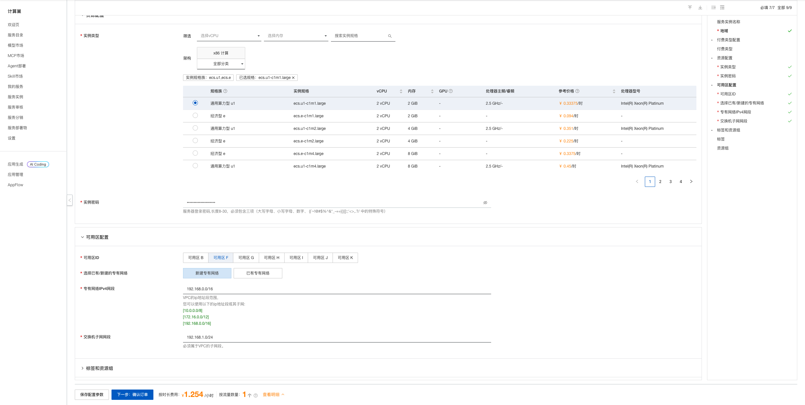
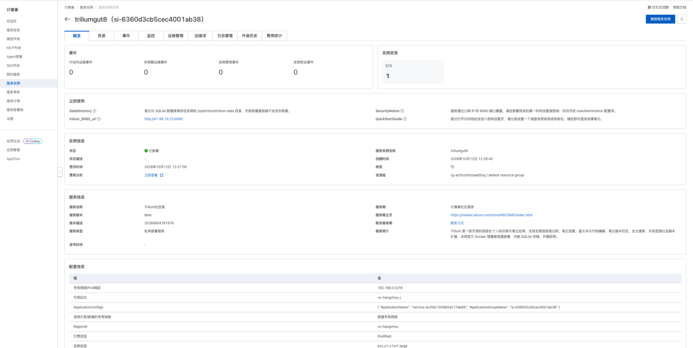
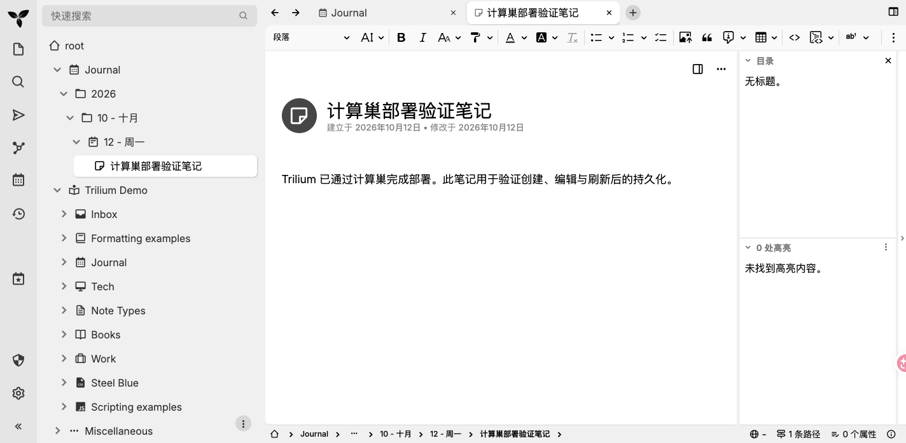

# Trilium 计算巢部署文档

## 概述

Trilium 是一款开源的层级化个人知识库与笔记应用，支持无限层级笔记树、富文本与代码编辑、全文搜索、笔记版本历史、关系图谱和脚本扩展。本方案使用官方 Docker 镜像部署在用户自己的阿里云账号中，数据保存在 ECS 本地目录，无需外部数据库。

| 项目 | 说明 |
| --- | --- |
| 服务 ID | `service-ac3fdc1928b04c17ab68` |
| 部署形态 | 单台 ECS + Docker |
| 应用镜像 | `triliumnext/trilium:v0.104.1` |
| 访问端口 | 8080（HTTP） |
| 数据存储 | ECS `/opt/trilium/trilium-data` |
| 实测部署耗时 | 约 71 秒 |

## 部署步骤

### 1. 打开创建页面

访问 [Trilium 服务实例创建页](https://computenest.console.aliyun.com/service/instance/create/cn-hangzhou?type=user&ServiceId=service-ac3fdc1928b04c17ab68)。

### 2. 配置部署参数

| 参数 | 说明 | 建议 |
| --- | --- | --- |
| 服务实例名称 | 控制台中用于识别本次部署 | 保持默认或自定义 |
| 地域 | ECS 所在地域 | 选择接近使用者的地域 |
| 付费类型 | 按量付费或包年包月 | 测试使用按量付费 |
| 实例类型 | ECS 规格 | 2 vCPU / 2 GiB 起 |
| 实例密码 | ECS 登录密码 | 使用符合页面规则的强密码 |
| 可用区 | ECS 所在可用区 | 选择有库存的可用区 |
| 专有网络 | 新建或复用 VPC | 首次部署可选择新建 |
| VPC/交换机网段 | 网络地址范围 | 无冲突时保持默认 |

填写完成并看到询价结果后，点击“下一步：确认订单”，核对资源和费用，勾选服务协议并创建实例。

### 3. 等待部署完成

进入服务实例详情页，等待状态变为“已部署”。本次实测从创建到部署完成约 71 秒。

“立即使用”区域会显示：

- `trilium_8080_url`：Trilium 访问地址；
- `QuickStartGuide`：首次访问说明；
- `SecurityNotice`：公网访问安全提示；
- `DataDirectory`：数据持久化目录。

## 首次访问与初始化

打开 `trilium_8080_url` 后依次完成：

1. 选择界面语言；
2. 选择“新建知识库”；
3. 选择演示内容或空白知识库；
4. 设置 Trilium 应用登录密码；
5. 使用刚设置的密码登录。

> Trilium 应用密码与 ECS 登录密码相互独立。部署完成后应立即设置强应用密码，切勿关闭身份认证。

登录后即可创建笔记、组织笔记树并使用全文搜索。

## 可用性验证

本次发布前验证结果：

| 验证项 | 结果 |
| --- | --- |
| 服务实例 | 状态为“已部署” |
| 应用访问 | Trilium 页面正常加载 |
| 初始化向导 | 语言、知识库来源、初始内容和密码设置均完成 |
| 身份认证 | 设置密码后必须登录 |
| 笔记读写 | 成功创建标题和正文 |
| 数据持久化 | 刷新页面后标题和正文仍存在 |

## 数据与安全

- 笔记和 SQLite 数据库保存在 `/opt/trilium/trilium-data`，并挂载到容器目录 `/home/node/trilium-data`。
- 数据位于用户自己的 ECS 中；删除 ECS 或服务实例前请先备份重要笔记。
- 默认通过公网 HTTP 8080 端口访问。生产环境建议限制安全组来源，并配置 HTTPS 反向代理。
- 不要启用 `TRILIUM_NO_AUTHENTICATION` 或其他免认证配置。
- Trilium 应用密码由应用管理，计算巢不会保存或展示其明文。

## 资源释放

不再使用时，在计算巢服务实例详情页执行“删除”。删除完成后建议继续确认：

1. 服务实例已不存在；
2. ROS 资源栈状态为 `DELETE_COMPLETE`；
3. ECS、VPC、交换机和安全组均无残留；
4. 账单中不再产生相关按量资源费用。

删除服务实例会同时删除 ECS 及其本地数据，请提前导出或备份重要笔记。

## 官方链接

- [Trilium 官方仓库](https://github.com/TriliumNext/Trilium)
- [Trilium 官方文档](https://docs.triliumnotes.org/)
- [Trilium Docker 安装文档](https://docs.triliumnotes.org/user-guide/setup/server/installation/docker)
- [阿里云计算巢文档](https://help.aliyun.com/zh/compute-nest/)
